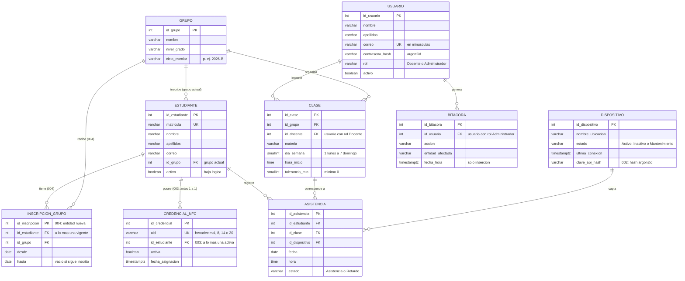

# Cambios al modelo entidad-relación entregado

El modelo entidad-relación del documento de modelado (4+1) tiene 8 entidades: USUARIO, GRUPO, CLASE, ESTUDIANTE, CREDENCIAL_NFC, DISPOSITIVO, ASISTENCIA y BITACORA. Al programar la API hicieron falta **tres cambios**. Este documento los explica para pasarlos al diagrama y al documento Word del modelado.

| # | Migración | Qué cambió | En una frase |
|---|---|---|---|
| 1 | `002_clave_dispositivo.sql` | DISPOSITIVO gana el atributo `clave_api_hash` | Cada lector se identifica con una clave secreta, y la base solo guarda su hash |
| 2 | `003_historial_credenciales.sql` | ESTUDIANTE–CREDENCIAL_NFC pasa de **1:1** a **1:N**, con a lo más una credencial activa | Al reponer una credencial perdida, la anterior se conserva en el historial |
| 3 | `004_inscripcion_grupo.sql` | Entidad nueva **INSCRIPCION_GRUPO** entre ESTUDIANTE y GRUPO | Se sabe desde y hasta cuándo estuvo cada estudiante en cada grupo |

Con los cambios, el modelo queda con **9 entidades**. Las migraciones ya fusionadas no se editan: cada cambio futuro será una migración nueva (`005_…`).

---

## 1. Clave del dispositivo (migración 002)

**Qué cambió:** DISPOSITIVO tiene un atributo nuevo, `clave_api_hash` (texto de hasta 255 caracteres).

**Por qué:** en el modelo entregado, nada impedía que cualquier equipo de la red enviara lecturas haciéndose pasar por un lector. Ahora cada lector manda su id y una clave secreta en cada lectura (`X-Dispositivo-Id` y `X-Dispositivo-Clave`), y la API la compara con el hash. La base **nunca guarda la clave en claro**: solo su hash argon2id, igual que las contraseñas de los usuarios (RNF-03). Si alguien copia la base, no puede usar las claves.

**Detalles:**

- La clave se genera o se cambia con `npm run dispositivo:clave -- <id>`, que la muestra una sola vez.
- Es obligatoria para los dispositivos nuevos o modificados (restricción `ck_dispositivo_clave_api_hash`). Se agregó como `NOT VALID` para no romper los dispositivos que ya existían antes de la migración; esos quedan sin poder registrar lecturas hasta que se les genera una clave.
- No cambia ninguna relación: solo agrega un atributo.

**Cómo dibujarlo:** agregar `clave_api_hash` a la entidad DISPOSITIVO.

## 2. Historial de credenciales (migración 003)

**Qué cambió:** la relación ESTUDIANTE «posee» CREDENCIAL_NFC pasa de **1:1** a **1:N**.

| | Antes (modelo entregado) | Ahora |
|---|---|---|
| Credenciales por estudiante | Exactamente una | Varias en el historial, **a lo más una activa** |
| Al reponer una credencial perdida | Se sobrescribía el UID y se perdía el anterior | La anterior queda con `activa = false` y su `fecha_asignacion`; se crea una nueva activa |
| Cómo se garantiza | `UNIQUE (id_estudiante)` | Índice único parcial `uq_credencial_nfc_estudiante_activa` sobre `(id_estudiante) WHERE activa` |

**Por qué:** las credenciales se pierden o se dañan. Con la relación 1:1, reponerla obligaba a borrar la anterior y se perdía la trazabilidad: no se podría saber con qué credencial se registró una asistencia antigua, ni detectar a alguien que siga usando una credencial reportada como perdida (sale `RECHAZADA` y queda constancia de que existió).

**Detalles:**

- `credencial_nfc.uid` sigue siendo `UNIQUE` en **toda** la tabla: una credencial reemplazada no puede volver a vincularse a nadie.
- Solo cuenta para la asistencia una credencial activa de un estudiante activo (RF-04).
- La misma migración instala la extensión **`unaccent`** de PostgreSQL, para que la búsqueda de estudiantes no distinga acentos («Lopez» encuentra a «López»). No es una tabla ni un atributo: **no cambia el diagrama**.

**Cómo dibujarlo:** cambiar la cardinalidad del lado de CREDENCIAL_NFC de «uno» a «muchos» (`||--o{` en la notación de abajo) y anotar la regla «a lo más una activa por estudiante».

## 3. Inscripción a grupos (migración 004)

**Qué cambió:** entidad nueva **INSCRIPCION_GRUPO**, entre ESTUDIANTE y GRUPO.

| Atributo | Tipo | Significado |
|---|---|---|
| `id_inscripcion` | entero, PK | |
| `id_estudiante` | entero, FK → ESTUDIANTE | |
| `id_grupo` | entero, FK → GRUPO | |
| `desde` | fecha | Primer día en el grupo |
| `hasta` | fecha, opcional | Último día en el grupo; vacío mientras sigue inscrito |

Relaciones: ESTUDIANTE 1—N INSCRIPCION_GRUPO y GRUPO 1—N INSCRIPCION_GRUPO.

**Por qué:** las faltas no se guardan: se calculan comparando quién **debía** estar en una clase con quién registró. Con el modelo entregado solo se sabía el grupo **actual** del estudiante (`estudiante.id_grupo`). Eso daba resultados falsos:

- Un estudiante dado de alta a mitad del semestre aparecía con faltas en todas las clases anteriores a su alta.
- Uno dado de baja dejaba de aparecer también en las clases en que sí estuvo.
- Uno que cambió de grupo se contaba en el grupo nuevo desde el principio.

Con INSCRIPCION_GRUPO, las estadísticas (P3) y la lista de asistencias (P2) solo cuentan a un estudiante en los días en que estaba inscrito. El día del alta y el de la baja no cuentan como falta.

**Detalles:**

- `estudiante.id_grupo` **se conserva** como el grupo actual (la relación GRUPO «inscribe» ESTUDIANTE del modelo sigue existiendo).
- A lo más una inscripción vigente por estudiante: índice único parcial `uq_inscripcion_grupo_vigente` sobre `(id_estudiante) WHERE hasta IS NULL`.
- `hasta` no puede ser anterior a `desde` (`ck_inscripcion_grupo_fechas`).
- **La tabla se mantiene sola con triggers**, sin que la API tenga que acordarse:

  | Evento en ESTUDIANTE | Trigger | Qué hace |
  |---|---|---|
  | Alta (`INSERT` activo) | `trg_estudiante_inscripcion_alta` | Abre una inscripción desde hoy |
  | Baja (`activo` pasa a `false`) | `trg_estudiante_inscripcion_cambio` | Cierra la vigente con `hasta` = hoy |
  | Cambio de grupo | `trg_estudiante_inscripcion_cambio` | Cierra la vigente y abre otra en el grupo nuevo |
  | Reactivación | `trg_estudiante_inscripcion_cambio` | Abre una nueva desde hoy |

- Al aplicar la migración se creó una inscripción para cada estudiante que ya existía, desde su fecha de alta.

**Cómo dibujarlo:** agregar la entidad INSCRIPCION_GRUPO con sus dos relaciones 1:N.

---

## Diagrama actualizado

Generado a partir de las migraciones `001` a `004`, y comprobado contra una base creada con ellas (`information_schema` y `pg_indexes`). GitHub lo dibuja solo; para el documento Word se puede exportar desde [mermaid.live](https://mermaid.live) pegando el bloque.

- Todas las tablas tienen además `created_at` y `updated_at`, que se omiten para que el diagrama se lea mejor.
- Los comentarios «002», «003» y «004» marcan lo que cambió respecto al modelo entregado.
- `UK` significa que el valor es único en la tabla.

### Reglas que el diagrama no muestra

Conviene mencionarlas en el documento del modelado, junto al diagrama:

- **Única** en ASISTENCIA: `(id_estudiante, id_clase, fecha)`. Un estudiante registra a lo más una vez por clase al día.
- **Faltas y pendientes no se guardan:** se calculan con ASISTENCIA, CLASE e INSCRIPCION_GRUPO. Por eso `asistencia.estado` solo admite «Asistencia» o «Retardo».
- **Ningún registro se borra:** todas las llaves foráneas son `ON DELETE RESTRICT`, y las bajas son lógicas (`activo = false`).
- **BITACORA es de solo inserción:** un trigger rechaza cualquier `UPDATE` o `DELETE` (RNF-03).
- **Roles validados por triggers:** `clase.id_docente` debe ser un Docente y `bitacora.id_usuario`, un Administrador.
